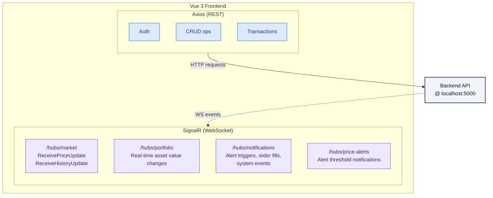

<div align="center">

#  Crypto Market Dashboard

**Real-time cryptocurrency tracking, trading, and portfolio management — all in one place.**

[](https://vuejs.org/)
[](https://www.typescriptlang.org/)
[](https://vitejs.dev/)
[](https://tailwindcss.com/)
[](https://learn.microsoft.com/aspnet/core/signalr/)

</div>

---

##  Overview

Crypto Market Dashboard is a feature-rich, real-time cryptocurrency platform built with **Vue 3 Composition API** and powered by **Microsoft SignalR** for live data streaming. It provides institutional-grade market tracking, portfolio management, limit order execution, price alerts, and an integrated news feed — all within a sleek, responsive interface styled with **Tailwind CSS 4**.

---

##  Features

| Category | Feature | Description |
|---|---|---|
|  **Live Market Data** | Real-time Price Updates | Prices stream via SignalR WebSocket with animated price-change indicators (up/down flash) |
|  **Interactive Charts** | Historical Price Charts | Candlestick & line charts powered by ApexCharts with configurable timeframes |
|  **Portfolio Management** | Wallet & Asset Tracking | View fiat balance, total invested value, individual asset holdings, and recent transactions |
|  **Trading** | Buy & Sell Coins | Execute market-price trades directly from coin detail pages |
|  **Limit Orders** | Conditional Trading | Set limit buy/sell orders that execute automatically when target price is reached |
|  **Price Alerts** | Custom Notifications | Configure alerts for specific price thresholds on any tracked coin |
|  **Notifications** | Real-time Alerts | Receive push notifications for triggered alerts, order fills, and system events via SignalR |
|  **Market News** | Integrated News Feed | Browse and read cryptocurrency market news with full article detail views |
|  **Authentication** | JWT-based Auth | Secure login & registration with automatic token injection via Axios interceptors |
|  **Wallet Operations** | Deposit & Withdraw | Manage fiat balance with secure, idempotent financial transactions |

---

##  Tech Stack

| Layer | Technology | Version | Purpose |
|---|---|---|---|
| **Framework** | [Vue 3](https://vuejs.org/) | `^3.5.29` | UI framework (Composition API) |
| **Build Tool** | [Vite](https://vitejs.dev/) | `^7.3.1` | Lightning-fast dev server & bundler |
| **Language** | [TypeScript](https://www.typescriptlang.org/) | — | Type-safe development |
| **Routing** | [Vue Router](https://router.vuejs.org/) | `^4.6.4` | SPA routing with history mode |
| **State Management** | [Pinia](https://pinia.vuejs.org/) | `^3.0.4` | Modular, type-safe stores |
| **Styling** | [Tailwind CSS](https://tailwindcss.com/) | `^4.2.4` | Utility-first CSS framework |
| **Charts** | [ApexCharts](https://apexcharts.com/) + `vue3-apexcharts` | `^5.13.0` | Interactive, responsive charts |
| **Real-time** | [Microsoft SignalR](https://learn.microsoft.com/aspnet/core/signalr/) | `^10.0.0` | WebSocket-based real-time communication |
| **HTTP Client** | [Axios](https://axios-http.com/) | `^1.15.2` | Promise-based HTTP with interceptors |
| **Icons** | [Lucide Vue Next](https://lucide.dev/) | `^0.475.0` | Beautiful, consistent icon set |
| **Typography** | [Inter](https://fonts.google.com/specimen/Inter) + [JetBrains Mono](https://fonts.google.com/specimen/JetBrains+Mono) | — | Premium font pairing |

---

##  Project Structure

```
frontend/
├── index.html                      # App entry point with Google Fonts & meta tags
├── package.json                    # Dependencies & scripts
├── vite.config.js                  # Vite + Vue + Tailwind plugin config
├── tailwind.config.js              # Tailwind CSS configuration
├── postcss.config.js               # PostCSS pipeline
│
├── public/                         # Static assets
│
└── src/
    ├── main.ts                     # App bootstrap (Vue, Pinia, Router)
    ├── App.vue                     # Root component
    │
    ├── api/                        # Service-oriented API layer
    │   ├── axios.ts                # Axios instance with JWT interceptors
    │   ├── signalRApi.ts           # SignalR connection manager (multi-hub)
    │   ├── authApi.ts              # Authentication endpoints
    │   ├── marketApi.ts            # Market data & trading endpoints
    │   ├── portfolioApi.ts         # Wallet & asset management (idempotent)
    │   ├── limitOrderApi.ts        # Limit order CRUD (idempotent)
    │   ├── priceAlertApi.ts        # Price alert management
    │   ├── notificationApi.ts      # Notification endpoints
    │   └── marketNewsApi.ts        # News feed endpoints
    │
    ├── stores/                     # Pinia state management
    │   ├── marketStore.ts          # Live coin data + SignalR (/hubs/market)
    │   ├── portfolioStore.ts       # Wallet & assets + SignalR (/hubs/portfolio)
    │   ├── limitOrderStore.ts      # Limit order state management
    │   ├── priceAlertStore.ts      # Price alerts + SignalR (/hubs/notifications)
    │   ├── notificationStore.ts    # Notifications + SignalR (/hubs/notifications)
    │   └── marketNewsStore.ts      # News feed state + SignalR (/hubs/price-alerts)
    │
    ├── types/                      # TypeScript type definitions
    │   ├── authTypes.ts            # Auth request/response types
    │   ├── marketTypes.ts          # Coin, PriceHistory, PriceUpdateMessage
    │   ├── portfolioTypes.ts       # Dashboard, Asset, Transaction types
    │   ├── limitOrderTypes.ts      # LimitOrderDto, Create/Update requests
    │   ├── priceAlertTypes.ts      # PriceAlertDto, CreatePriceAlertRequest
    │   ├── notificationTypes.ts    # NotificationDto types
    │   └── marketNewsTypes.ts      # News article types
    │
    ├── views/                      # Page-level components
    │   ├── HomeView.vue            # Landing / dashboard overview
    │   ├── MarketView.vue          # Full market listing with live prices
    │   ├── CoinDetailView.vue      # Individual coin: chart, trade, orders
    │   ├── PortfolioView.vue       # Wallet, assets, and transactions
    │   ├── MarketNewsView.vue      # News feed listing
    │   ├── NewsDetailView.vue      # Full news article view
    │   ├── LoginView.vue           # User login
    │   └── RegisterView.vue        # User registration
    │
    ├── components/                 # Reusable UI components
    │   ├── NavBar.vue              # Main navigation bar
    │   ├── NotificationDropdown.vue    # Real-time notification panel
    │   ├── PriceAlertDropdown.vue      # Price alert management panel
    │   ├── market/
    │   │   ├── CoinTable.vue       # Market data table with live updates
    │   │   └── NewsList.vue        # News article cards
    │   └── portfolio/
    │       ├── AssetTable.vue      # Portfolio asset holdings table
    │       └── TransactionTable.vue    # Transaction history table
    │
    ├── layouts/                    # Layout wrappers
    │   └── MainLayout.vue          # Authenticated layout with NavBar
    │
    └── routers/                    # Route definitions
        └── index.ts                # Vue Router config with nested routes
```

---

## Getting Started

### Prerequisites

| Requirement | Version |
|---|---|
| **Node.js** | `^20.19.0` or `>=22.12.0` |
| **npm** | Bundled with Node.js |
| **Backend API** | Running at `http://localhost:5000` |

### Installation

```bash
# 1. Clone the repository
git clone https://github.com/ibrahimkabadayi/crypto-market-dashboard.git
cd crypto-market-dashboard/frontend

# 2. Install dependencies
npm install

# 3. Start the development server
npm run dev
```

The app will be available at `http://localhost:5173` (Vite default).

### Available Scripts

| Command | Description |
|---|---|
| `npm run dev` | Start Vite dev server with HMR |
| `npm run build` | Build production bundle to `dist/` |
| `npm run preview` | Preview the production build locally |

---

##  Architecture

### API Communication

The application uses a **dual-channel communication** architecture:



**REST API (Axios)** — Standard request/response for CRUD operations, authentication, and financial transactions.

**SignalR Hubs** — Persistent WebSocket connections for real-time push updates:

| Hub | Purpose | Events |
|---|---|---|
| `/hubs/market` | Live price streaming | `ReceivePriceUpdate`, `ReceiveHistoryUpdate` |
| `/hubs/portfolio` | Portfolio value updates | Real-time asset value changes |
| `/hubs/notifications` | Push notifications | Alert triggers, order fills, system events |
| `/hubs/price-alerts` | Price alert monitoring | Alert threshold notifications |

### SignalR Connection Management

The [`SignalRService`](src/api/signalRApi.ts) class provides a centralized, multi-hub connection manager with:

- **Multi-hub support** — Manages multiple concurrent SignalR connections via an internal `Map`
- **Automatic reconnection** — Progressive backoff strategy: `[0, 0, 1000, 3000, 5000, 10000]` ms
- **Transport fallback** — WebSockets → Long Polling
- **JWT authentication** — Optional per-hub token injection via `accessTokenFactory`
- **Lifecycle hooks** — `onclose`, `onreconnecting`, `onreconnected` handlers

### State Management (Pinia)

Six dedicated stores provide modular, reactive state:

| Store | Responsibility |
|---|---|
| `marketStore` | Coin data, price history, SignalR integration |
| `portfolioStore` | Wallet, assets, transactions, portfolio SignalR |
| `limitOrderStore` | Limit order CRUD and state |
| `priceAlertStore` | Price alert management and notifications |
| `notificationStore` | User notification lifecycle |
| `marketNewsStore` | News feed data and updates |

---

## Security & Reliability

### JWT Authentication

- **Automatic token injection** — Axios request interceptor attaches `Bearer <token>` from `localStorage` on every API call
- **Error interception** — Response interceptor catches and logs API errors for consistent error handling
- **Token-based SignalR auth** — Authenticated hubs receive JWT via `accessTokenFactory`

### Idempotent Financial Operations

All financial transactions (deposits, withdrawals, buy/sell, limit orders) include an **`Idempotency-Key`** header with a `crypto.randomUUID()` value. This prevents duplicate transaction processing in case of:

- Network retries
- User double-clicks
- Connection interruptions

**Protected endpoints:**
- `portfolioApi` — deposit, withdraw, buyCoin, sellCoin
- `limitOrderApi` — all CRUD operations (create, read, update, delete)

```typescript
// Example: Idempotency header generation
const getFinancialHeaders = () => ({
    headers: {
        'Idempotency-Key': crypto.randomUUID()
    }
});
```

### Real-time Connection Resilience

- **Automatic reconnection** with configurable backoff intervals
- **Connection state monitoring** — prevents duplicate connection starts
- **Graceful degradation** — fallback from WebSocket to Long Polling
- **Manual retry** — 5-second retry on initial connection failure

---

## Route Map

| Path | View | Auth Required | Description |
|---|---|---|---|
| `/login` | `LoginView` | ❌ | User authentication |
| `/register` | `RegisterView` | ❌ | New account creation |
| `/` | `HomeView` | ✅ | Dashboard overview |
| `/market` | `MarketView` | ✅ | Live market data table |
| `/market/:symbol` | `CoinDetailView` | ✅ | Coin detail with charts & trading |
| `/portfolio` | `PortfolioView` | ✅ | Wallet, assets, and transactions |
| `/market-news` | `MarketNewsView` | ✅ | News feed listing |
| `/market-news/:title` | `NewsDetailView` | ✅ | Full article view |

> All authenticated routes are wrapped within `MainLayout`, which provides the `NavBar` with notification and price alert dropdowns.

---

## Key Dependencies

### Production

| Package | Purpose |
|---|---|
| `vue` `^3.5.29` | Reactive UI framework |
| `pinia` `^3.0.4` | State management |
| `vue-router` `^4.6.4` | Client-side routing |
| `axios` `^1.15.2` | HTTP client |
| `@microsoft/signalr` `^10.0.0` | Real-time communication |
| `apexcharts` `^5.13.0` | Chart rendering engine |
| `vue3-apexcharts` `^1.11.1` | Vue 3 ApexCharts wrapper |
| `lucide-vue-next` `^0.475.0` | Icon library |

### Development

| Package | Purpose |
|---|---|
| `vite` `^7.3.1` | Build tool & dev server |
| `@vitejs/plugin-vue` `^6.0.4` | Vue 3 SFC support |
| `tailwindcss` `^4.2.4` | Utility-first CSS |
| `@tailwindcss/vite` `^4.2.4` | Tailwind Vite integration |
| `postcss` `^8.5.13` | CSS post-processing |
| `vite-plugin-vue-devtools` `^8.0.6` | Vue DevTools integration |

---

## Contributing

1. Fork the repository
2. Create your feature branch (`git checkout -b feature/amazing-feature`)
3. Commit your changes (`git commit -m 'Add amazing feature'`)
4. Push to the branch (`git push origin feature/amazing-feature`)
5. Open a Pull Request

---

## License

This project is licensed under the [MIT License](LICENSE).

---

<div align="center">

**Built using Vue 3, SignalR, and ApexCharts**

</div>
